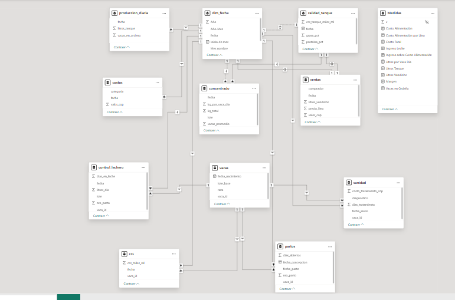

# Tablero de producción de leche · Power BI

Tablero gerencial para fincas ganaderas que permite monitorear 
producción, costos, hato y reproducción desde una sola vista.

## Qué muestra
- **Resumen gerencial:** litros por vaca, margen, costo de alimentación y vacas en ordeño
- **Hato y producción:** vacas de bajo rendimiento, CCS y días abiertos
- **Costos y margen:** desglose por categoría y evolución mensual

## Tecnologías
Power BI · Power Query · DAX · Python · Excel

## Pipeline del proyecto
1. Generación de datos simulados con Python (`generar_datos.py`)
2. Auditoría de calidad con Python (`auditor.py`) — detecta errores por celda
3. Transformación y limpieza en Power Query
4. Modelado en estrella en Power BI (dim_fecha, vacas → tablas de hechos)
5. Medidas DAX y visualización gerencial

## Datos
Datos simulados con parámetros zootécnicos reales. 
Generados con Python para representar una ganadería de leche colombiana.

## Capturas

